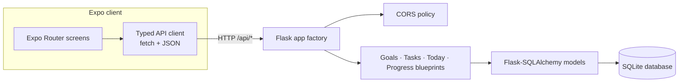
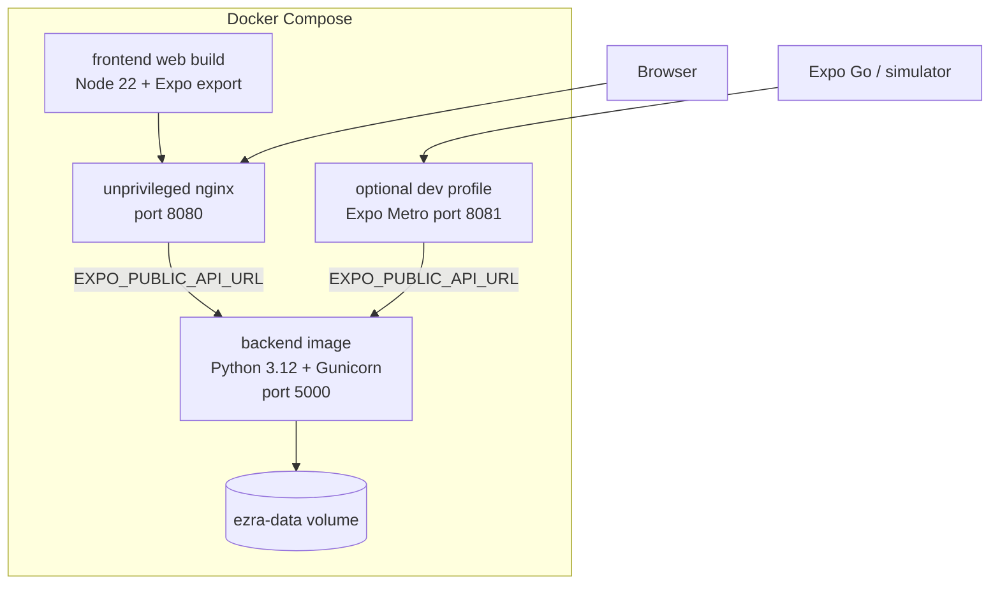

# EZRA Technical Documentation

This guide describes the system in the source files and lockfiles. Version and command details match the files as of 2026-11-24. These files are `frontend/package.json`, `frontend/package-lock.json`, the Python requirements files, and the Docker files.

## System overview

EZRA is a self-care application for one user. The Expo client has welcome and login screens, a Today dashboard, goals, task lists, and progress screens. The client calls a Flask JSON API. Flask stores goals, tasks, goal check-ins, and goal edit history in SQLite.



### Runtime and deployment paths



- **Web:** The frontend Docker target builds a static Expo web app. nginx serves the app. The build embeds `WEB_API_URL`. Rebuild the `web` image when you change this value.
- **Mobile development:** The optional `metro` Compose profile serves the app to Expo Go or a simulator. A phone must use the computer's LAN IP address to reach the API.
- **Native builds:** Docker does not build iOS or Android apps. This repository has no `ios/` or `android/` folders or EAS build configuration. You can configure Expo's managed workflow and EAS for a native build.
- **Storage:** Compose mounts the `ezra-data` volume at `/data`. The backend image uses `sqlite:////data/ezra.db`. A local backend uses a database in Flask's instance folder.

## Request and data flow

1. A screen in `frontend/src/app/` calls a function in `frontend/src/api/client.ts`.
2. The client sends JSON to `EXPO_PUBLIC_API_URL`. It adds the `/api` prefix. It converts network failures and API errors to `ApiError` messages.
3. The Flask app factory registers route blueprints and JSON error handlers. It sets the CORS origins and calls `db.create_all()`.
4. Route handlers validate requests. They read or update SQLAlchemy models and return JSON.

The API uses the `/api` prefix. It has no version number or OpenAPI specification. Requests use JSON. Dates use `YYYY-MM-DD`. Timestamps use ISO 8601 UTC. The client sends the user's local date with date-based requests. This prevents errors near midnight when the client and server use different time zones.

The backend has no authentication or user separation. Anyone who can reach the API can read and change the database. Use this service for development. Do not expose it to the public internet.

### API route inventory

| Method | Path | Purpose |
| --- | --- | --- |
| `GET` | `/api/health` | Health check (`{"status":"ok"}`) |
| `GET` | `/api/today?date=YYYY-MM-DD` | Returns scheduled goal check-ins, open tasks due by that date, and summary counts. |
| `PATCH` | `/api/occurrences/{id}` | Sets the check-in status to `pending`, `done`, or `skipped`. |
| `GET`, `POST` | `/api/goals` | Lists goals or creates a goal. The list accepts `include_archived=true`. |
| `GET`, `PATCH`, `DELETE` | `/api/goals/{id}` | Reads, edits, archives, or deletes a goal. |
| `GET` | `/api/goals/{id}/revisions` | Returns goal edit history, newest first. |
| `GET` | `/api/goals/{id}/occurrences?from=&to=` | Returns check-ins in a date range. |
| `GET`, `POST` | `/api/tasks` | Lists or creates tasks. The list accepts `done` and `goal_id` filters. |
| `GET`, `PATCH`, `DELETE` | `/api/tasks/{id}` | Reads, changes, or deletes a task. |
| `GET` | `/api/progress?days=7&end=YYYY-MM-DD` | Returns completion totals, daily counts, goal rates, and recovery suggestions. |

Goal schedules use weekday numbers. `0` is Monday and `6` is Sunday. An empty schedule means every day. The API creates check-ins when a client requests `/api/today`. Skipped check-ins do not count in completion rates. Recovery suggestions use a threshold. They are not a validated behavior model.

See the [API reference in the codebase guide](../CODEBASE.md#api-reference) for request and response shapes.

## Repository map

| Path | Responsibility |
| --- | --- |
| `frontend/src/app/` | Expo Router routes. The root `index.tsx`, `login.tsx`, and `home.tsx` files provide the landing flow. `(tabs)/` contains Today, Lists, Goals, and Progress. `tasks/` and `goals/` contain create and detail screens. |
| `frontend/src/components/` | Shared controls and screens. These include task cards, check rows, forms, the tab bar, request states, progress charts, and focus cards. |
| `frontend/src/api/client.ts` | Base URL, JSON request/error handling, and typed API methods. |
| `frontend/src/types/models.ts` | TypeScript shapes corresponding to API responses and inputs. |
| `frontend/src/constants/theme.ts` | Shared colors, spacing, radii, and typography. |
| `frontend/src/lib/` | Date utilities, API hooks, haptics, and navigation helpers. |
| `frontend/assets/` | App icon, splash icon, and platform icon assets. |
| `backend/app/__init__.py` | Flask application factory, configuration, CORS, route registration, and table creation. |
| `backend/app/routes/` | HTTP endpoint handlers grouped by goals, tasks, today/check-ins, and progress. |
| `backend/app/models.py` | Goal, Task, Occurrence, and Revision database models. |
| `backend/app/validation.py`, `errors.py` | Validates input and formats JSON error responses. |
| `backend/app/extensions.py` | Shared Flask-SQLAlchemy extension instance. |
| `backend/tests/` | Pytest API test fixtures and endpoint coverage. |
| `docker-compose.yml` | Backend, static web, and opt-in Metro services and named volumes. |
| `backend/Dockerfile` | Python/Gunicorn API image. |
| `frontend/Dockerfile` | Node dependencies, Metro development target, Expo web export, and nginx runtime stages. |
| `frontend/nginx.conf` | SPA fallback, compression, and static asset caching rules. |

## Install and run the project

### Supported toolchain

- **Node.js:** Use version 22.13 or newer. `frontend/AGENTS.md` sets this minimum. The Dockerfile uses the `node:22-slim` tag.
- **Python:** Use Python 3.12 for local development. The backend image uses `python:3.12-slim`.
- **Docker:** Install Docker Engine and the Docker Compose plugin to run all services together.
- **Expo Go:** Use Expo Go to test on a phone. Connect the phone and computer to the same network. Set the API URL to the computer's LAN address.

### Run with Docker Compose

From the repository root:

```bash
docker compose up --build
```

Open the web app at `http://localhost:8080`. Check the API at `http://localhost:5000/api/health`.

Compose reads optional values from a root `.env` file. This repository does not include a root `.env.example` file. The default settings support a browser on the same computer. To use Expo Go on a phone, create a root `.env` file with the computer's LAN address. For example:

```dotenv
LAN_IP=192.168.1.20
WEB_API_URL=http://192.168.1.20:5000
CORS_ORIGINS=http://localhost:8080,http://192.168.1.20:8080
```

Then start the Metro profile:

```bash
docker compose --profile dev up --build metro
```

Run `docker compose down` to stop the containers. Run `docker compose down -v` to delete the SQLite data and Metro dependency cache.

### Manual backend

```bash
cd backend
python3.12 -m venv .venv
source .venv/bin/activate             # Windows PowerShell: .venv\Scripts\Activate.ps1
python -m pip install -r requirements-dev.txt
python run.py
```

The API listens on `0.0.0.0:5000`. The default database is SQLite. The default CORS origin is the Expo web app on port 8081. `run.py` does not load `.env` files. To set configuration, export these variables before you start the server:

```bash
export DATABASE_URL=sqlite:///ezra.db
export CORS_ORIGINS=http://localhost:8081
export PORT=5000
```

Run backend checks from `backend/`:

```bash
pytest
```

### Manual frontend

```bash
cd frontend
npm ci
cp .env.example .env
npm start
```

Edit `frontend/.env`. Set `EXPO_PUBLIC_API_URL` to the API address. Use `http://localhost:5000` for a browser or emulator on the same computer. Use `http://<computer-LAN-IP>:5000` on a phone. In the Expo CLI, press `w` to open the web app. Or scan the QR code with Expo Go.

Frontend checks:

```bash
npm run lint
npm run typecheck
```

Use `npx expo install <package>` to add an Expo-compatible library. Check SDK compatibility before you change Expo package versions by hand.

## API, SDKs, runtimes, and libraries

The **Resolved version** column lists the exact top-level versions in `frontend/package-lock.json`. `frontend/package.json` uses version ranges for some packages. The Python requirements files set version constraints. They do not lock exact versions. The Python table lists the constraints, not the installed versions.

### Frontend direct dependencies

| Package | Role | Resolved version | License | Source |
| --- | --- | ---: | --- | --- |
| `@expo/vector-icons` | Icon set | 15.1.1 | MIT | [npm](https://www.npmjs.com/package/@expo/vector-icons) |
| `expo` | App framework and CLI/runtime integration | 57.0.26 | MIT | [npm](https://www.npmjs.com/package/expo) |
| `expo-constants` | App and runtime configuration | 57.0.20 | MIT | [npm](https://www.npmjs.com/package/expo-constants) |
| `expo-haptics` | Haptic feedback | 57.0.3 | MIT | [npm](https://www.npmjs.com/package/expo-haptics) |
| `expo-linking` | Deep links and URL handling | 57.0.11 | MIT | [npm](https://www.npmjs.com/package/expo-linking) |
| `expo-router` | File-based navigation | 57.0.24 | MIT | [npm](https://www.npmjs.com/package/expo-router), [docs](https://docs.expo.dev/router/introduction/) |
| `expo-status-bar` | Status bar control | 57.0.1 | MIT | [npm](https://www.npmjs.com/package/expo-status-bar) |
| `react` | UI library | 19.2.3 | MIT | [npm](https://www.npmjs.com/package/react) |
| `react-dom` | React web renderer | 19.2.3 | MIT | [npm](https://www.npmjs.com/package/react-dom) |
| `react-native` | Native UI runtime | 0.86.3 | MIT | [npm](https://www.npmjs.com/package/react-native) |
| `react-native-safe-area-context` | Safe-area layout support | 5.7.0 | MIT | [npm](https://www.npmjs.com/package/react-native-safe-area-context) |
| `react-native-screens` | Native screen primitives | 4.26.2 | MIT | [npm](https://www.npmjs.com/package/react-native-screens) |
| `react-native-svg` | SVG rendering | 15.15.4 | MIT | [npm](https://www.npmjs.com/package/react-native-svg) |
| `react-native-web` | React Native web renderer | 0.21.3 | MIT | [npm](https://www.npmjs.com/package/react-native-web) |

### Frontend development dependencies

| Package | Role | Resolved version | License | Source |
| --- | --- | ---: | --- | --- |
| `@types/react` | React TypeScript declarations | 19.2.18 | MIT | [npm](https://www.npmjs.com/package/@types/react) |
| `eslint` | Linter | 9.39.5 | MIT | [npm](https://www.npmjs.com/package/eslint) |
| `eslint-config-expo` | Expo lint rules | 57.0.2 | MIT | [npm](https://www.npmjs.com/package/eslint-config-expo) |
| `typescript` | TypeScript compiler | 6.0.3 | Apache-2.0 | [npm](https://www.npmjs.com/package/typescript) |

The lockfile lists all npm packages and their registry archive URLs. The [npm dependency and license inventory](DEPENDENCY_LICENSES.csv) lists all 853 package entries, their versions, license data, and source archives. Thirty-eight entries have no license data in the lockfile. Check those packages before you redistribute the app. Run `npm ls --all` to view the installed packages. Review the license notices for the files in a production bundle.

### Backend direct dependencies

| Package | Role | Declared version | License | Source |
| --- | --- | --- | --- | --- |
| `Flask` | HTTP application framework | `~=3.1` | BSD-3-Clause | [PyPI](https://pypi.org/project/Flask/), [source](https://github.com/pallets/flask) |
| `Flask-SQLAlchemy` | Flask integration for SQLAlchemy | `~=3.1` | BSD License | [PyPI](https://pypi.org/project/Flask-SQLAlchemy/), [source](https://github.com/pallets-eco/flask-sqlalchemy) |
| `Flask-Cors` | Browser CORS headers | `~=6.0` | MIT | [PyPI](https://pypi.org/project/Flask-Cors/), [source](https://github.com/corydolphin/flask-cors) |
| `gunicorn` | WSGI server in Docker | `~=26.2` | MIT | [PyPI](https://pypi.org/project/gunicorn/), [source](https://github.com/benoitc/gunicorn) |
| `pytest` (development only) | Backend test runner | `~=9.0` | MIT | [PyPI](https://pypi.org/project/pytest/), [source](https://github.com/pytest-dev/pytest) |

`Flask-SQLAlchemy` uses SQLAlchemy. Python includes SQLite in its standard library. The current files do not lock transitive Python package versions. Add a Python lockfile to record these versions. You can also create an inventory from one specific environment.

### Platform and service versions

| Tool or service | Version source in repository | License | Source |
| --- | --- | --- | --- |
| Expo SDK | `expo: ~57.0.25`; lock resolves 57.0.26 | MIT | [Expo SDK 57 docs](https://docs.expo.dev/versions/v57.0.0/) |
| React Native | 0.86.3 | MIT | [npm](https://www.npmjs.com/package/react-native) |
| Expo Router | Manifest `~57.0.23`; lock resolves 57.0.24 | MIT | [npm](https://www.npmjs.com/package/expo-router), [Router docs](https://docs.expo.dev/router/introduction/) |
| Node.js | `node:22-slim` in frontend Dockerfile; local minimum 22.13 | MIT for Node.js; bundled components carry their own notices | [Node.js](https://nodejs.org/), [source and license](https://github.com/nodejs/node) |
| Python | `python:3.12-slim` in backend Dockerfile | PSF-2.0 for CPython; image OS components have separate notices | [Python 3.12 docs](https://docs.python.org/3.12/), [source and license](https://github.com/python/cpython) |
| SQLite | Python standard-library `sqlite3` and SQLAlchemy SQLite dialect; version comes from Python image | Public domain | [SQLite](https://sqlite.org/) |
| nginx | `nginxinc/nginx-unprivileged:stable-alpine` | BSD-2-Clause for nginx; the Alpine image contains separately licensed packages | [Image source](https://github.com/nginxinc/docker-nginx-unprivileged), [nginx license](https://nginx.org/LICENSE) |
| Docker Compose | Compose file version field omitted; installed plugin supplies the version | Apache-2.0 for the Compose plugin | [Compose source and license](https://github.com/docker/compose) |
| Expo Go (optional) | Version installed by the developer; not pinned by this repository | Proprietary application; not bundled as a project dependency | [Expo Go](https://expo.dev/go) |

The Dockerfiles use base image tags: `node:22-slim`, `python:3.12-slim`, and `nginxinc/nginx-unprivileged:stable-alpine`. These tags do not identify a fixed patch version or image digest. Operating system packages in these images have their own licenses.

Use `frontend/package.json` and `frontend/package-lock.json` as the source for frontend package versions. The `node_modules` folder can contain different versions if it came from another branch or an old container volume.

## Data model and persistence

- **Goal:** title, description, weekday schedule, local start date, archived flag, and creation time.
- **Task:** title, notes, completion state, optional due date, optional goal relationship, and timestamps.
- **Occurrence:** one scheduled goal check-in per goal/date, with a unique `(goal_id, date)` constraint and `pending`, `done`, or `skipped` status.
- **Revision:** goal edit snapshot containing changed fields and an optional note.

The app creates tables with `db.create_all()`. This creates missing tables. It does not change existing tables. Add a migration system before you change a schema that contains real data. Gunicorn uses one worker with SQLite. This avoids concurrent writes and table-creation conflicts at startup.

## Configuration reference

| Variable | Used by | Default | Purpose |
| --- | --- | --- | --- |
| `EXPO_PUBLIC_API_URL` | Expo client | `http://localhost:5000` | Backend origin; included in the web bundle at build time |
| `DATABASE_URL` | Flask API | `sqlite:///ezra.db` | SQLAlchemy database URL; Compose sets it to `/data/ezra.db` |
| `CORS_ORIGINS` | Flask API / Compose | `http://localhost:8081` in Flask; Compose supplies 8080 and 8081 origins | Comma-separated allowed browser origins |
| `PORT` | `backend/run.py` | `5000` | Local development server port; the Docker Gunicorn command binds explicitly to 5000 |
| `WEB_API_URL` | Compose web build arg | `http://localhost:5000` | Value passed to `EXPO_PUBLIC_API_URL` for static web export |
| `LAN_IP` | Compose Metro profile | `localhost` | Host address advertised to physical devices for Metro and API access |

## Licensing and notices

This repository has no root `LICENSE` file for EZRA. Third-party licenses do not set the license for this project. Add a project license before you redistribute EZRA.

The tables above list direct package sources, versions, and license identifiers. `frontend/package-lock.json` lists npm transitive packages. The Python requirements do not pin transitive package versions. Check each license against the package you distribute. Keep third-party copyright and license notices in distributed builds.

## Known technical limits

- The API has no authentication, account system, or separate data for multiple users.
- The repository has no production setup for HTTPS, secret storage, backups, or database upgrades.
- SQLite, one Gunicorn worker, and `db.create_all()` support a small development deployment.
- The API has no OpenAPI document or version segment.
- Backend package versions are not fixed by a lockfile.
- Some Docker base image tags can point to different image versions over time.
- The login screen is a design flow. It does not send credentials to an authentication service.

## Primary reference files

- [Root README](../README.md)
- [Docker setup](../DOCKER.md)
- [Backend setup](../backend/README.md)
- [Codebase guide with API shapes and component details](../CODEBASE.md)
- [Frontend README](../frontend/README.md)
- [Frontend agent/development requirements](../frontend/AGENTS.md)
- [Frontend package manifest](../frontend/package.json) and [lockfile](../frontend/package-lock.json)
- [Backend runtime requirements](../backend/requirements.txt) and [development requirements](../backend/requirements-dev.txt)
- [Docker Compose configuration](../docker-compose.yml)
