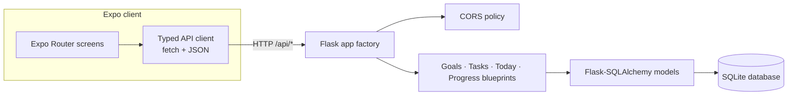
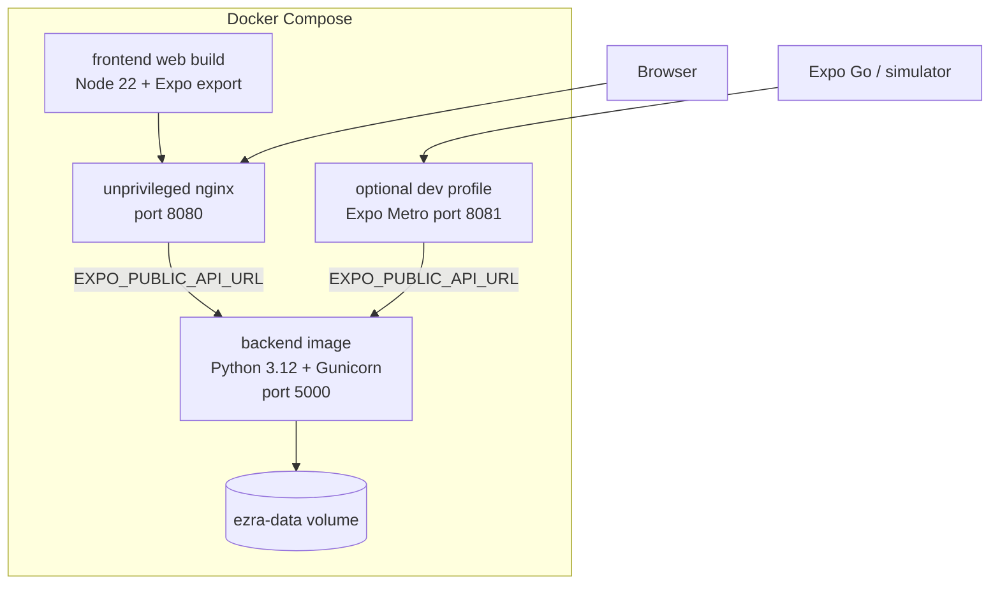

# EZRA Technical Documentation

This guide describes the system represented by the checked-in source and lockfiles. Dependency versions and commands below were checked against `frontend/package.json`, `frontend/package-lock.json`, the Python requirements files, and the Docker configuration on 2026-11-24.

## System overview

EZRA is a single-user self-care application. The Expo client provides welcome/login presentation pages, a Today dashboard, goals, task lists, and progress views. The client calls a Flask JSON API. Flask persists goals, task records, goal check-ins, and goal edit history in SQLite.



### Runtime and deployment paths



- **Web:** the frontend Docker target builds a static Expo web export and serves it through nginx. `WEB_API_URL` is embedded at build time; changing it requires rebuilding the `web` image.
- **Mobile development:** the optional `metro` Compose profile serves JavaScript to Expo Go or a simulator. A phone must use the computer's LAN IP for the backend URL.
- **Native builds:** Docker does not build iOS or Android binaries. The repository has no checked-in `ios/` or `android/` directories; native builds use Expo's managed/CNG workflow and EAS when configured.
- **Storage:** Compose mounts a named `ezra-data` volume at `/data`; the backend image defaults to `sqlite:////data/ezra.db`. Direct local runs default to a database under Flask's instance directory.

## Request and data flow

1. A screen in `frontend/src/app/` calls a function on the typed API object in `frontend/src/api/client.ts`.
2. The client sends JSON to `EXPO_PUBLIC_API_URL` with the `/api` prefix. Network failures and API error bodies are converted to `ApiError` messages.
3. The Flask app factory registers route blueprints, applies the configured CORS origins, registers JSON error handlers, and calls `db.create_all()`.
4. Route handlers validate request data, read or update SQLAlchemy models, and return JSON.

The API is unversioned beyond its `/api` prefix and does not currently publish an OpenAPI specification. Requests use JSON. Dates are ISO `YYYY-MM-DD`; timestamps are ISO-8601 UTC. The client sends the user's local date for date-based queries to avoid server-timezone errors around midnight.

The backend has **no authentication or per-user isolation**. Anyone who can reach the API can read and modify the same database. It is a development service and should not be exposed to the public internet as-is.

### API route inventory

| Method | Path | Purpose |
| --- | --- | --- |
| `GET` | `/api/health` | Health check (`{"status":"ok"}`) |
| `GET` | `/api/today?date=YYYY-MM-DD` | Scheduled goal occurrences, open tasks due by that date, and summary counts |
| `PATCH` | `/api/occurrences/{id}` | Set a check-in to `pending`, `done`, or `skipped` |
| `GET`, `POST` | `/api/goals` | List goals or create one; supports `include_archived=true` on list |
| `GET`, `PATCH`, `DELETE` | `/api/goals/{id}` | Read, edit/archive, or delete a goal |
| `GET` | `/api/goals/{id}/revisions` | Goal edit history, newest first |
| `GET` | `/api/goals/{id}/occurrences?from=&to=` | Occurrences in a date range |
| `GET`, `POST` | `/api/tasks` | List or create tasks; supports `done` and `goal_id` filters |
| `GET`, `PATCH`, `DELETE` | `/api/tasks/{id}` | Read, update, or delete a task |
| `GET` | `/api/progress?days=7&end=YYYY-MM-DD` | Completion totals, daily series, per-goal rates, and recovery suggestions |

Goal schedules use weekday numbers `0=Monday` through `6=Sunday`; an empty schedule means every day. Occurrences are created lazily when `/api/today` is requested. Skipped check-ins are excluded from completion rates. The recovery suggestions use a simple threshold heuristic and are not a validated behavior model.

## Repository map

| Path | Responsibility |
| --- | --- |
| `frontend/src/app/` | Expo Router routes. Root `index.tsx`, `login.tsx`, and `home.tsx` provide the landing flow; `(tabs)/` contains Today, Lists, Goals, and Progress; `tasks/` and `goals/` contain create/detail screens. |
| `frontend/src/components/` | Reusable controls and UI: task cards, check rows, forms, tab bar, empty/error/loading states, progress charts, and focus cards. |
| `frontend/src/api/client.ts` | Base URL, JSON request/error handling, and typed API methods. |
| `frontend/src/types/models.ts` | TypeScript shapes corresponding to API responses and inputs. |
| `frontend/src/constants/theme.ts` | Shared colors, spacing, radii, and typography. |
| `frontend/src/lib/` | Date utilities, API hooks, haptics, and navigation helpers. |
| `frontend/assets/` | App icon, splash icon, and platform icon assets. |
| `backend/app/__init__.py` | Flask application factory, configuration, CORS, route registration, and table creation. |
| `backend/app/routes/` | HTTP endpoint handlers grouped by goals, tasks, today/check-ins, and progress. |
| `backend/app/models.py` | Goal, Task, Occurrence, and Revision database models. |
| `backend/app/validation.py`, `errors.py` | Input validation and consistent JSON error responses. |
| `backend/app/extensions.py` | Shared Flask-SQLAlchemy extension instance. |
| `backend/tests/` | Pytest API test fixtures and endpoint coverage. |
| `docker-compose.yml` | Backend, static web, and opt-in Metro services and named volumes. |
| `backend/Dockerfile` | Python/Gunicorn API image. |
| `frontend/Dockerfile` | Node dependencies, Metro development target, Expo web export, and nginx runtime stages. |
| `frontend/nginx.conf` | SPA fallback, compression, and static asset caching rules. |

## Installation and local development

### Supported toolchain

- **Node.js:** `frontend/AGENTS.md` requires Node.js 22.13 or newer. The frontend Dockerfile uses the moving `node:22-slim` image tag.
- **Python:** the backend image uses `python:3.12-slim`. For local development, use Python 3.12.
- **Docker:** Docker Engine with the Docker Compose plugin is the recommended full-stack setup.
- **Expo Go:** optional for device development. A physical phone and development computer must be on a network that can reach the same LAN API address.

### Recommended: Docker Compose

From the repository root:

```bash
docker compose up --build
```

Open the web client at `http://localhost:8080`; the API health endpoint is `http://localhost:5000/api/health`.

Compose reads optional variables from a root `.env` file. There is no root `.env.example` in this repository. The Compose defaults work for browser-on-the-same-machine development. To use Expo Go on a phone, create a root `.env` with the computer's LAN address, for example:

```dotenv
LAN_IP=192.168.1.20
WEB_API_URL=http://192.168.1.20:5000
CORS_ORIGINS=http://localhost:8080,http://192.168.1.20:8080
```

Then start the Metro profile:

```bash
docker compose --profile dev up --build metro
```

Stop containers with `docker compose down`. **`docker compose down -v` removes the SQLite data volume and Metro dependency cache.**

### Manual backend

```bash
cd backend
python3.12 -m venv .venv
source .venv/bin/activate             # Windows PowerShell: .venv\Scripts\Activate.ps1
python -m pip install -r requirements-dev.txt
python run.py
```

The API binds to `0.0.0.0:5000`. Defaults use SQLite and allow the local Expo web origin on port 8081. To configure the process, export variables before running it; `run.py` does not load `.env` files itself:

```bash
export DATABASE_URL=sqlite:///ezra.db
export CORS_ORIGINS=http://localhost:8081
export PORT=5000
```

Run backend checks from `backend/` with `pytest`.

### Manual frontend

```bash
cd frontend
npm ci
cp .env.example .env
npm start
```

Edit `frontend/.env` and set `EXPO_PUBLIC_API_URL` to the API address. Keep `http://localhost:5000` for a browser or emulator on the same machine; use `http://<computer-LAN-IP>:5000` on a physical device. In the Expo CLI, press `w` for web or scan the QR code with Expo Go.

Frontend checks:

```bash
npm run lint
npm run typecheck
```

Install Expo-compatible libraries with `npx expo install <package>`. Avoid manually changing Expo package versions without checking SDK compatibility.

## API, SDKs, runtimes, and libraries

Versions in the frontend **Resolved version** column are the exact top-level versions recorded by `frontend/package-lock.json`. The frontend manifest contains ranges for some packages. Python requirements use compatible-release constraints and **there is no Python lockfile**, so the table lists declared constraints, not the exact versions installed in a particular environment.

### Frontend direct dependencies

| Package | Role | Resolved version | License | Source |
| --- | --- | ---: | --- | --- |
| `@expo/vector-icons` | Icon set | 15.1.1 | MIT | [npm](https://www.npmjs.com/package/@expo/vector-icons) |
| `expo` | App framework and CLI/runtime integration | 57.0.26 | MIT | [npm](https://www.npmjs.com/package/expo) |
| `expo-constants` | App and runtime configuration | 57.0.20 | MIT | [npm](https://www.npmjs.com/package/expo-constants) |
| `expo-haptics` | Haptic feedback | 57.0.3 | MIT | [npm](https://www.npmjs.com/package/expo-haptics) |
| `expo-linking` | Deep links and URL handling | 57.0.11 | MIT | [npm](https://www.npmjs.com/package/expo-linking) |
| `expo-router` | File-based navigation | 57.0.24 | MIT | [npm](https://www.npmjs.com/package/expo-router), [docs](https://docs.expo.dev/router/introduction/) |
| `expo-status-bar` | Status bar control | 57.0.1 | MIT | [npm](https://www.npmjs.com/package/expo-status-bar) |
| `react` | UI library | 19.2.3 | MIT | [npm](https://www.npmjs.com/package/react) |
| `react-dom` | React web renderer | 19.2.3 | MIT | [npm](https://www.npmjs.com/package/react-dom) |
| `react-native` | Native UI runtime | 0.86.3 | MIT | [npm](https://www.npmjs.com/package/react-native) |
| `react-native-safe-area-context` | Safe-area layout support | 5.7.0 | MIT | [npm](https://www.npmjs.com/package/react-native-safe-area-context) |
| `react-native-screens` | Native screen primitives | 4.26.2 | MIT | [npm](https://www.npmjs.com/package/react-native-screens) |
| `react-native-svg` | SVG rendering | 15.15.4 | MIT | [npm](https://www.npmjs.com/package/react-native-svg) |
| `react-native-web` | React Native web renderer | 0.21.3 | MIT | [npm](https://www.npmjs.com/package/react-native-web) |

### Frontend development dependencies

| Package | Role | Resolved version | License | Source |
| --- | --- | ---: | --- | --- |
| `@types/react` | React TypeScript declarations | 19.2.18 | MIT | [npm](https://www.npmjs.com/package/@types/react) |
| `eslint` | Linter | 9.39.5 | MIT | [npm](https://www.npmjs.com/package/eslint) |
| `eslint-config-expo` | Expo lint rules | 57.0.2 | MIT | [npm](https://www.npmjs.com/package/eslint-config-expo) |
| `typescript` | TypeScript compiler | 6.0.3 | Apache-2.0 | [npm](https://www.npmjs.com/package/typescript) |

The lockfile contains the full transitive npm dependency graph and registry tarball URLs. The companion [npm dependency and license inventory](DEPENDENCY_LICENSES.csv) lists all 853 package entries in the checked-in lockfile with resolved version, declared license metadata, and source archive. Thirty-eight entries do not declare a license in the lockfile; inspect those package archives before redistribution. Use `npm ls --all` to inspect the installed tree. Review license notices for the precise artifacts included in a production bundle.

### Backend direct dependencies

| Package | Role | Declared version | License | Source |
| --- | --- | --- | --- | --- |
| `Flask` | HTTP application framework | `~=3.1` | BSD-3-Clause | [PyPI](https://pypi.org/project/Flask/), [source](https://github.com/pallets/flask) |
| `Flask-SQLAlchemy` | Flask integration for SQLAlchemy | `~=3.1` | BSD License | [PyPI](https://pypi.org/project/Flask-SQLAlchemy/), [source](https://github.com/pallets-eco/flask-sqlalchemy) |
| `Flask-Cors` | Browser CORS headers | `~=6.0` | MIT | [PyPI](https://pypi.org/project/Flask-Cors/), [source](https://github.com/corydolphin/flask-cors) |
| `gunicorn` | WSGI server in Docker | `~=26.2` | MIT | [PyPI](https://pypi.org/project/gunicorn/), [source](https://github.com/benoitc/gunicorn) |
| `pytest` (development only) | Backend test runner | `~=9.0` | MIT | [PyPI](https://pypi.org/project/pytest/), [source](https://github.com/pytest-dev/pytest) |

`Flask-SQLAlchemy` depends on SQLAlchemy; SQLite is provided by Python's standard library. The Python transitive dependency versions are not locked and cannot be enumerated reproducibly from the current files. A reproducible software bill of materials for Python requires creating and checking in a resolved lock file or generating one from a specific environment.

### Platform and service versions

| Tool or service | Version source in repository | License | Source |
| --- | --- | --- | --- |
| Expo SDK | `expo: ~57.0.25`; lock resolves 57.0.26 | MIT | [Expo SDK 57 docs](https://docs.expo.dev/versions/v57.0.0/) |
| React Native | 0.86.3 | MIT | [npm](https://www.npmjs.com/package/react-native) |
| Expo Router | Manifest `~57.0.23`; lock resolves 57.0.24 | MIT | [npm](https://www.npmjs.com/package/expo-router), [Router docs](https://docs.expo.dev/router/introduction/) |
| Node.js | `node:22-slim` in frontend Dockerfile; local minimum 22.13 | MIT for Node.js; bundled components carry their own notices | [Node.js](https://nodejs.org/), [source and license](https://github.com/nodejs/node) |
| Python | `python:3.12-slim` in backend Dockerfile | PSF-2.0 for CPython; image OS components have separate notices | [Python 3.12 docs](https://docs.python.org/3.12/), [source and license](https://github.com/python/cpython) |
| SQLite | Python standard-library `sqlite3` and SQLAlchemy SQLite dialect; version comes from Python image | Public domain | [SQLite](https://sqlite.org/) |
| nginx | `nginxinc/nginx-unprivileged:stable-alpine` | BSD-2-Clause for nginx; the Alpine image contains separately licensed packages | [Image source](https://github.com/nginxinc/docker-nginx-unprivileged), [nginx license](https://nginx.org/LICENSE) |
| Docker Compose | Compose file version field omitted; installed plugin supplies the version | Apache-2.0 for the Compose plugin | [Compose source and license](https://github.com/docker/compose) |
| Expo Go (optional) | Version installed by the developer; not pinned by this repository | Proprietary application; not bundled as a project dependency | [Expo Go](https://expo.dev/go) |

Docker base tags (`node:22-slim`, `python:3.12-slim`, `nginxinc/nginx-unprivileged:stable-alpine`) are not pinned to patch versions or image digests. Their operating-system packages also have licenses independent of the direct libraries listed above.

The package-manager manifest/lockfile is the authoritative source for library versions. `node_modules` is not a source of truth: it may contain a different version if dependencies were installed from another branch or reused from a container volume.

## Data model and persistence

- **Goal:** title, description, weekday schedule, local start date, archived flag, and creation time.
- **Task:** title, notes, completion state, optional due date, optional goal relationship, and timestamps.
- **Occurrence:** one scheduled goal check-in per goal/date, with a unique `(goal_id, date)` constraint and `pending`, `done`, or `skipped` status.
- **Revision:** goal edit snapshot containing changed fields and an optional note.

Tables are initialized with `db.create_all()`. It creates missing tables but does not migrate existing schema. Use a migration system before making schema changes after real data exists. SQLite is configured with one Gunicorn worker to avoid concurrent write and startup table-creation races.

## Configuration reference

| Variable | Used by | Default | Purpose |
| --- | --- | --- | --- |
| `EXPO_PUBLIC_API_URL` | Expo client | `http://localhost:5000` | Backend origin; included in the web bundle at build time |
| `DATABASE_URL` | Flask API | `sqlite:///ezra.db` | SQLAlchemy database URL; Compose sets it to `/data/ezra.db` |
| `CORS_ORIGINS` | Flask API / Compose | `http://localhost:8081` in Flask; Compose supplies 8080 and 8081 origins | Comma-separated allowed browser origins |
| `PORT` | `backend/run.py` | `5000` | Local development server port; the Docker Gunicorn command binds explicitly to 5000 |
| `WEB_API_URL` | Compose web build arg | `http://localhost:5000` | Value passed to `EXPO_PUBLIC_API_URL` for static web export |
| `LAN_IP` | Compose Metro profile | `localhost` | Host address advertised to physical devices for Metro and API access |

## Licensing and notices

This repository does not currently include a root `LICENSE` file declaring EZRA's own license. Third-party license notices do not establish the project's license. Confirm and add a project license before redistributing the application.

The direct dependency inventory above records package sources, resolved or declared versions, and upstream license identifiers. npm transitive packages are captured in `frontend/package-lock.json`; Python transitive packages are not pinned. License metadata comes from the package manager lockfile or upstream package metadata and should be checked against the exact artifact before distribution. Preserve third-party copyright and license notices in distributed builds.

## Known technical limits

- No authentication, account system, or multi-user data partitioning.
- No production deployment recipe for HTTPS, secrets management, backups, or database upgrades.
- SQLite, one Gunicorn worker, and `db.create_all()` target a small development deployment.
- The API has no OpenAPI document or explicit version segment.
- Backend dependency constraints are not reproducible without a Python lockfile.
- Several Docker base images use moving tags instead of immutable digests.
- The landing login screen is a design/navigation flow; credentials are not sent to an authentication service.

## Primary reference files

- [Root README](../README.md)
- [Docker setup](../DOCKER.md)
- [Backend README and detailed endpoints](../backend/README.md)
- [Frontend README](../frontend/README.md)
- [Frontend agent/development requirements](../frontend/AGENTS.md)
- [Frontend package manifest](../frontend/package.json) and [lockfile](../frontend/package-lock.json)
- [Backend runtime requirements](../backend/requirements.txt) and [development requirements](../backend/requirements-dev.txt)
- [Docker Compose configuration](../docker-compose.yml)
